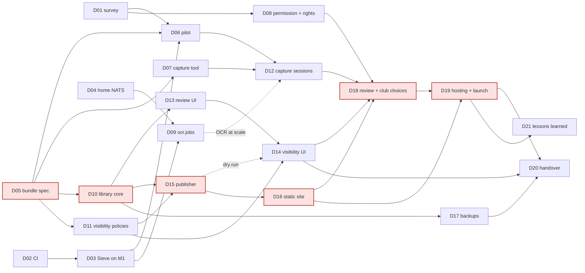

# Epic: the Branford Garden Club archive

Status: **plan**, 2026-11-20. Work starts the week of **Nov 23, 2026**; launch by **Jan 17, 2027**.

The first real deployment of Athena@Home, and a deliberately easy one: a shoebox of a garden club's paper records
and past publications, turned into a reviewed private library and the club's first website. It proves the whole
pipeline on a real collection:

```
capture ──► Sieve (OCR) ──► library ──► publisher ──► static site
 iPhone /     M1 Mac mini     Ubuntu mini   Ubuntu mini    a host the
 flatbed /    ocr.page,       originals,    feeds,         club picks
 PIXY         ocr.jobs        tiers, review redaction      (+ domain)
```

The club's historian and archivist (**"the archivist"** below) holds the collection and makes the club's choices
with its board. Athena@Home supplies the mechanism (visibility tiers, policies, redaction, feeds); **the club
decides what is public**. Everything starts private.

Design references: [design.md](../../design.md) (modules composed per deployment), [portal.md](../../portal.md)
(tiers, policies, feeds, static site), [backend.md](../../backend.md) (derivation and build order),
[phase0-results.md](../../phase0-results.md), and `docs/sieve.md` on `feat/sieve`.

## Goal

Capture, OCR and review the whole shoebox; let the club choose what is public and what is for members; launch the
club's first site from those choices; prove the backups by restoring them; and write down what we learned for the
next deployment.

## Success criteria

1. **Captured**: every item in the shoebox is in the library, and the capture log reconciles with the week-1 count
   (D01) box by box, folder by folder. Nothing is left "to do later" without a written reason.
2. **OCR'd**: every page has tier-1 text, or is marked *image only* with a reason (photo, handwriting the pilot
   showed OCR can't read). OCR accuracy per material type is measured on the pilot's ground truth (D06).
3. **Reviewed**: every item has status `reviewed` from the archivist: title, date (or circa), series and type
   checked, and OCR spot-checked.
4. **The club has chosen**: permission to digitize and to publish is recorded (D08); a visibility setting or policy
   covers every series; every item's effective visibility is the result of those choices (D18).
5. **Launched**: the public site is live on the club's chosen host (and domain, if wanted); the members build is
   live too if the club wants one at launch. The pre-launch leak tests pass on the exact build that ships (D16,
   D19).
6. **Backups proven**: 3-2-1 copies exist, and a restore onto a clean machine passes: every original's sha256
   matches and the site rebuilds from the restored library (D17).
7. **Lessons written**: a lessons-learned note with measured numbers, plus a sanitized example deployment config
   for the next one (D21).
8. **Nothing real in git**: no record, page image, transcription or member's personal data is ever committed; CI
   enforces it (D02).

## Scope

- Sieve on the M1 Mac mini (`ocr.page`, then `ocr.jobs`), home NATS on the Ubuntu mini.
- A capture bundle spec with archival metadata (collection → series → item → page) and a capture tool that turns
  iPhone, flatbed and PIXY images into bundles.
- A pilot of ~50 real pages that decides the capture method and measures OCR on old material.
- The library MVP: named instances, write-once originals, SQLite + FTS5, visibility tiers and policies,
  `library.events`.
- A minimal review UI for metadata, OCR checks, visibility choices and redaction.
- The publisher (feeds, burned-in redaction, web derivatives and zoom tiles) and a static site with Pagefind
  search per tier, plus an optional members build behind the host's login.
- Hosting, domain and launch; backups with a restore test; a handover guide; lessons learned.

## Non-goals (later, and why)

| Later | Why it can wait |
|---|---|
| **Live portal** with member logins | A static site plus host auth covers a club; nothing of the club's needs to run on the internet. |
| **Tier-2 AI extraction** (local LLM fields) | A shoebox is small enough for the archivist to describe items by hand; extraction pays off on larger or ongoing collections. |
| **athena-mcp** and cloud AI access | No one has asked for it; it widens the privacy surface. |
| **Vector search service** (myvect-derived) | Pagefind on the site and FTS5 in the library answer exact searches over ~2,500 pages. |
| **Guest and car feeds**, library-to-library sync | Not part of this deployment; the feed format built here is the one they will reuse. |
| **Corrected transcriptions** of all OCR text | The site labels text as uncorrected machine OCR; the archivist corrects what matters. |
| **Handwriting recognition** | Untested; the pilot decides whether handwritten pages get any OCR at all. |
| **Formal FADGI conformance** (DICE targets, star ratings) | We aim at FADGI-like resolution (400 ppi documents, 600 ppi photos); formal testing needs targets and software we don't have. |
| **OCRX port**, iPhone app, Linux camera station | The capture tool imports image folders from any camera; that's enough to prove the pipeline. |
| **Per-person accounts and roles** beyond two local logins | Two people use the review UI. |
| **Incremental publishing** from `library.events` | A full rebuild of a shoebox-sized site takes minutes. Events are emitted now so incremental builds can come later. |
| **NAS**, FamilyFinances, Home Assistant | Household deployment, not this one. |

## Deliverables

One file per deliverable in this folder. Sizes are working days for one ops agent (or, for human tasks, the
people named). Week numbers are in the calendar below.

| ID | Deliverable | Type | Size | Depends on | Week |
|---|---|---|---|---|---|
| [D01](D01-archive-survey.md) | Count and sort the shoebox; draft series list; pick the pilot sample | human-archivist | 1 | — | W1 |
| [D02](D02-ci.md) | CI: tests on Linux, macOS-only skips, SPDX and no-real-records guards | code | 1 | — | W1 |
| [D03](D03-sieve-on-m1.md) | Sieve on the M1 and ready for its PR | code + ops | 2 | D02 | W1 |
| [D04](D04-home-nats.md) | Home NATS on the Ubuntu mini (nsc, JetStream, TLS, systemd) | ops | 2 | — | W1–W2 |
| [D05](D05-capture-bundle.md) | Capture bundle spec v1 with archival metadata | code | 2 | — | W1 |
| [D06](D06-capture-pilot.md) | Capture method pilot: ~50 pages, OCR scoring, decision | ops + human | 3 | D01, D03, D05 | W1–W2 |
| [D07](D07-capture-tool.md) | Capture tool: import, item grouping, metadata entry, quality checks | code | 3 | D05 | W2 |
| [D08](D08-permission-and-rights.md) | Permission to digitize and publish; rights inventory | human-archivist | 1 | D01 | W1–W3 |
| [D09](D09-sieve-ocr-jobs.md) | Sieve `ocr.jobs`: durable queue, retry, dead-letter | code | 3 | D03, D04 | W2 |
| [D10](D10-library-core.md) | Library MVP: named instances, intake, originals, schema, FTS5, events | code | 4 | D05 | W2–W3 |
| [D11](D11-visibility-policies.md) | Visibility tiers, policies and effective visibility | code | 3 | D05 | W2–W3 |
| [D12](D12-capture-sessions.md) | Capture sessions: runbook, then the whole shoebox | ops + human | 1 + sessions | D06, D07 | W2–W7 |
| [D13](D13-review-ui.md) | Review UI: metadata, OCR check, review status | code | 3 | D10 | W3 |
| [D14](D14-visibility-ui.md) | Review UI: visibility choices, policies view, redaction | code | 3 | D11, D13, D15 | W4 |
| [D15](D15-publisher.md) | Publisher: feeds, redaction burn-in, derivatives, zoom tiles | code | 3 | D10, D11 | W3–W4 |
| [D16](D16-static-site.md) | Static site: Pagefind per tier, optional members build, leak tests | code | 3 | D15 | W4 |
| [D17](D17-backups.md) | Backups (3-2-1), restore test, BagIt export | ops | 2 | D10 | W4, W7 |
| [D18](D18-review-and-club-choices.md) | Archivist's review pass and the club's visibility choices | human-archivist | sessions | D08, D12, D14, D16 | W4–W7 |
| [D19](D19-hosting-and-launch.md) | Hosting, domain and launch | ops | 2 | D16, D18 | W7–W8 |
| [D20](D20-handover.md) | Handover guide and training for the archivist and the club | doc | 2 | D14, D17, D19 | W7–W8 |
| [D21](D21-lessons-learned.md) | Lessons learned and an example deployment config | doc | 1 | D19 | W8 |

**Agent work**: 43 days across code, ops and docs deliverables (about 37 of them before the preview), against 18 working
days before the holidays plus two weeks in January. Three agents in parallel have 54 agent-days before Dec 18, so
the code is done by the preview with room to spare; the critical path below is what sets the date.
**Human work**: D01, D08, D12's sessions (about 6–8 sessions of 2–3 hours, decided by D06's throughput numbers)
and D18.

## Calendar

| Week | Dates | Working days | What happens |
|---|---|---|---|
| **W1** | Nov 23–27 | 3 (**Thanksgiving** Thu 26, Fri 27 off) | Survey and count (D01); ask for permission (D08); CI (D02); Sieve on the M1 (D03); bundle spec (D05); NATS starts (D04); pilot fixtures and scorer (D06); pilot pages captured if the shoebox is at hand |
| **W2** | Nov 30–Dec 4 | 5 | **Pilot scored and capture method decided by Wed Dec 2** (D06); capture tool (D07); `ocr.jobs` (D09); library core starts (D10); policy engine (D11); runbook (D12); first capture session with separator sheets |
| **W3** | Dec 7–11 | 5 | Library core done (D10); review UI (D13); publisher starts (D15); capture sessions; first overnight OCR batches |
| **W4** | Dec 14–18 | 5 | Visibility UI and redaction (D14); static site (D16); backups (D17); **preview site for the archivist and board by Fri Dec 18** (private: local or behind host auth); review pass starts (D18) |
| **W5** | Dec 21–25 | holiday (**Christmas** Fri 25) | No planned agent work. Buffer. The archivist may browse the preview. |
| **W6** | Dec 28–Jan 1 | holiday (**New Year's Day** Fri 1) | No planned agent work. Buffer. |
| **W7** | Jan 4–8 | 5 | Remaining capture and review; **the club's choices recorded by Fri Jan 8** (D18); host and domain set up (D19); restore test (D17); handover draft (D20) |
| **W8** | Jan 11–15 | 5 | Pre-launch audit; **launch Wed Jan 13**; training (D20); lessons learned (D21). Jan 14–17 is slack before the **Jan 17** deadline. |

Milestones:

| Milestone | Date | Proof |
|---|---|---|
| M1 Pipeline skeleton | Wed Nov 25 | Sieve answers `ocr.page` on the M1; bundle spec merged into the epic branch; shoebox counted |
| M2 Capture method chosen | Wed Dec 2 | D06 decision note with scores and pages/hour |
| M3 Library holds real items | Fri Dec 11 | first capture sessions ingested and OCR'd, searchable in the review UI |
| M4 Preview site | Fri Dec 18 | static site built from the library, shown privately to the archivist and board |
| M5 Club's choices recorded | Fri Jan 8 | permission recorded; every series covered by a setting or policy |
| M6 Launch | Wed Jan 13 | site live; leak tests pass on the shipped build; restore test passed |
| M7 Close-out | Fri Jan 15 | handover done; lessons learned written |

## Dependency graph



D09 → D12 is dashed: capture sessions don't wait for `ocr.jobs`. Until it lands, a batch command runs pages through
`ocr.page` (D10 has that fallback). D15 → D14 is dashed: only D14's "what's public" view needs the publisher's dry
run; the rest of D14 starts without it.

## Critical path

**To the preview (code)**: D05 bundle spec (2) → D10 library core (4) → D15 publisher (3) → D16 static site (3)
= **12 working days**, against 18 available before Fri Dec 18. D11 runs beside D10 because the policy engine is a
pure module over the hierarchy D05 defines; it joins D10 for D15.

**To the launch (people)**: D01 survey → D08 permission → preview (M4) → D18 the club's choices (by Jan 8) → D19
launch. This is the real critical path: the code is done in December, but the club's permission and decisions
depend on people who are busy over the holidays and may need a board meeting. Everything else has slack; this
doesn't. Two things protect it:

- **Ask early.** The permission request (D08) goes out in W1, and the date of the board's next meeting is the
  first open question.
- **Launch smaller rather than later.** Everything is private by default, so if the decisions are partial on
  Jan 8, the launch publishes only what has been decided (say, the club's own past publications) and the rest
  follows by changing configuration and rebuilding. A smaller launch on time beats a full one late.

Capture is the second-longest chain (D01 → D06 → D12 → D18) and has buffer in W7.

## Risks

| # | Risk | Likelihood / impact | Mitigation |
|---|---|---|---|
| R1 | **OCR is poor on old material** (mimeograph, old typefaces, newsprint clippings, handwriting); it's validated only on clean synthetic print | High / medium | W1–W2 pilot on ~50 real pages across decades (D06) with synthetic historical fixtures to test the scorer; per-material decision: OCR, OCR labelled "uncorrected", or image-only; the site says text is machine OCR; the archivist corrects the text that matters (titles, names on key pages). |
| R2 | **The club's permission and choices slip past the holidays** (board meets monthly or not at all in December) | Medium / high | Ask in W1 (D08); show a private preview Dec 18; give the board a one-page choices sheet (D18), not the software; launch with what's decided and add the rest later. |
| R3 | **Something private leaks through the site**: a redaction that misses a zoom tile, members text in the public search index, iPhone GPS in image metadata, a private item in a feed | Low / high | Canary-string leak tests over every output byte, including decompressed Pagefind fragments and every zoom level (D15, D16); EXIF/XMP stripped from all derivatives; public and members builds are separate builds and separate deploys; pre-launch audit on the exact build that ships (D19); a takedown procedure with cache purge. |
| R4 | **Capture is slower than planned** (flatbed at 400–600 ppi is ~40–60 pages/hour; 2,500 pages would be 40+ hours) | Medium / medium | D06 measures pages/hour per method; camera (iPhone 48 MP on a stand) for most pages, flatbed for photos and small or fragile items; separator sheets so capture never waits for the tool; W7 is a catch-up week. |
| R5 | **Originals lost before backups exist** (a disk fails in December) | Low / high | From the first session: copy each session's raw images to a second disk before leaving (D12 runbook). D17 automates 3-2-1 in W4. Paper goes back to the archivist unchanged. |
| R6 | **The M1 is slower or tighter than the M3 laptop** where Sieve was measured; bf16 untested | Medium / low | 8-bit is already exact on key fields; OCR runs overnight (~2,500 pages × 10–15 s ≈ 7–10 hours); the M3 laptop can run Sieve as a second worker in the same queue group. |
| R7 | **Damage to fragile items** during capture | Low / high | Camera over flatbed for bound or brittle items; no unfolding of brittle folds; handling notes in the runbook; the archivist decides what is too fragile to capture. |
| R8 | **Bus factor**: one author, agents' work to integrate | Medium / medium | The site is static (keeps running with nothing of ours online); the club owns the host and domain accounts; BagIt export on a disk for the club; handover guide (D20). |
| R9 | **Scope creep** (live portal, AI extraction, search service) | Medium / medium | Non-goals above; anything new goes to "later" with a sentence on why. |
| R10 | **The site doesn't fit the host**: some static hosts cap files per deployment, and Deep Zoom tiles for 2,500 pages run to hundreds of thousands of files | Medium / medium | D15 defaults to a three-size image pyramid (~3 files per page); D16 records size and file count; D19's comparison lists each host's limits. |

## Open questions

| # | Question | Owner | Needed by |
|---|---|---|---|
| Q1 | **When does the club's board next meet**, and can it decide by email? | archivist | Tue Nov 24 |
| Q2 | **Where are the records, and where does capture happen** (the archivist's home or the author's, where the M1 and Ubuntu mini are)? Can the records travel? | author + archivist | Tue Nov 24 |
| Q3 | **Merge order**: merge PR #3 (`docs/backend-plan`) first and rebase `feat/sieve` onto `main`? (D03 assumes yes) | author | Mon Nov 23 |
| Q4 | **Permission**: who can grant permission to digitize and to publish (president, board vote)? Is an email enough, or a motion in the minutes? | archivist | ask Wed Nov 25; digitize by Fri Dec 4; publish by Fri Jan 8 |
| Q5 | **Which host** (the options and their costs are in D19)? Whose account (it should be the club's)? | club, via the archivist | Fri Dec 18 |
| Q6 | **A domain?** Which name, who registers and pays (in the club's name), and who renews it? | club | Fri Dec 18 (Fri Jan 8 at the latest) |
| Q7 | **A members side at launch**, or public only? If yes, who manages the member list? | club | Fri Dec 18; final Fri Jan 8 |
| Q8 | **Rights in clippings and photos**: who were the photographers; are living people identifiable; may newspaper clippings after 1931 be public? (Not legal advice; D08 lists what to ask.) | archivist + club | Fri Jan 8 |
| Q9 | **Membership directories, addresses and phone numbers**: private, members-only, or redacted? | club | Fri Jan 8 |
| Q10 | **Handwritten records**: transcribe some by hand, keep image-only, or leave them out of the site? | archivist | Fri Dec 4 (after the pilot) |
| Q11 | **Off-site backup**: a second encrypted disk kept at the archivist's home, or an encrypted cloud bucket (only ciphertext leaves the house)? | author + club | Fri Dec 11 |
| Q12 | **Takedown contact**: who on the site receives "please remove this" requests? | club | Fri Jan 8 |
| Q13 | **After launch**: who adds new items, and does the club want its own copy (a BagIt export on a disk)? | club | Fri Jan 8 |

## Week-1 checklist (Nov 23–25)

People:

- [ ] Author: decide the merge order (Q3) and tell the agents.
- [ ] Archivist: answer Q1 and Q2.
- [ ] Archivist: count and sort the shoebox into rough groups, list them, note condition (D01).
- [ ] Archivist: pick ~50 pilot pages across the decades and material types (D01).
- [ ] Archivist: send the permission request to the club (D08; template in D08).
- [ ] Author: confirm the M1 is free for Sieve (FileVault on) and the Ubuntu mini's library disk is encrypted.
- [ ] Author: get a ruler or printed scale and a grey card for capture; check the iPhone shoots 48 MP.
- [ ] Author: turn off iCloud Photos on the iPhone used for capture (or use a phone without it), so no record is
      uploaded to the cloud.

Agents:

- [ ] D02 CI green on the epic branch, including the no-real-records guard.
- [ ] D03 Sieve installed on the M1; 31 tests and the end-to-end test pass there; M1 timings recorded.
- [ ] D05 bundle spec, JSON Schema and validator on `feat/capture-bundle`.
- [ ] D04 nsc operator and accounts generated; `nats-server` running with JetStream on the Ubuntu mini.
- [ ] D06 synthetic historical fixtures and the pilot scorer, tested in CI.

## Rules every deliverable follows

- **Core modules, composed per deployment.** No club or household names in code. Each library is a named instance
  with its own data directory, config and address. Libraries share only through publisher-built feeds. Everything
  is private by default, and the club's choices are configuration. The club's real configuration lives in the
  library's data directory, not in git; the repo carries a sanitized example (D21).
- **No cloud OCR or AI processing of records**, and nothing from the author's work infrastructure (the
  Ancera/Hydra NATS hub, AKS, Azure, the work `myvect` MCP connector).
- **Derive, don't depend.** Code adapted from myvect or HaberDash carries `SPDX-License-Identifier:
  GPL-3.0-or-later` and a provenance line (see [backend.md](../../backend.md#provenance)).
- **Never commit real records or personal data.** Tests use synthetic fixtures (extend `phase0/gen_testset.py`).
  Pilot and review results are committed as aggregate numbers only.
- **Every code deliverable has tests and acceptance criteria.** MLX and Apple Vision tests skip cleanly on Linux.
- **Agents work on feature branches and report back; they don't merge or open PRs.** The author opens PRs when the
  work is ready, after tests and experiments. Each deliverable names its branch. Code branches start from `main`
  once PR #3 is merged (Q3); a deliverable that needs code not yet on `main` branches from its dependency's branch
  and says so in its report, so the author can merge in dependency order.

## Change to the build order

[backend.md](../../backend.md#build-order)'s build order is updated for this deployment:

- **Capture moves ahead of the library.** The library's intake consumes capture bundles, and the pilot needs
  capture first, so the bundle spec (D05) is the first library-side work and the capture tool (D07) comes before
  the library is finished. It's a folder importer, not OCRX's "Send to library", which stays later.
- **The search service moves after the publisher, to "later".** FTS5 in the library and Pagefind on the site cover
  a shoebox; vector search earns its place on larger collections.
- **Visibility tiers, policies and the publisher come before extraction and the review queue's confidence
  thresholds.** The club needs choices and a site; it doesn't need machine-extracted fields.
